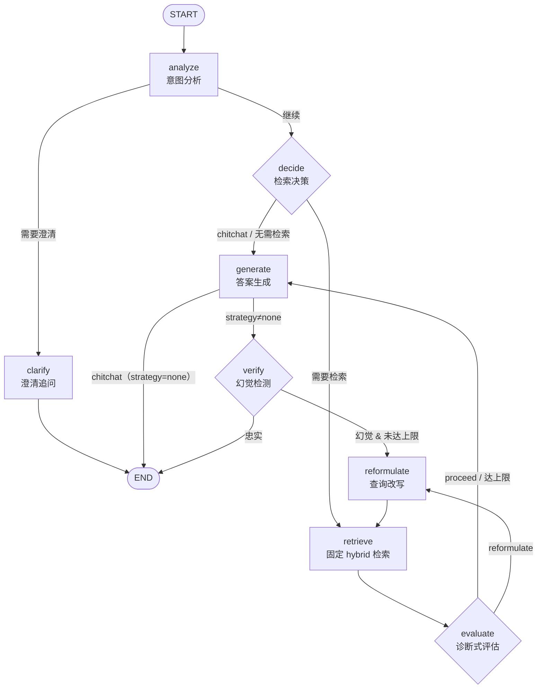

# RAGForge

[](https://github.com/yyc2417/RAGForge/actions/workflows/ci.yml)

> Agentic RAG —— LangGraph 状态机驱动的自适应检索增强生成系统

RAGForge 是一个**基于 LangGraph 的可控 Agentic RAG 系统**：7 节点主链路分析查询意图，需要检索时固定使用 **hybrid**（向量 + BM25 + RRF，可选重排），对检索结果做**诊断式评估**（区分“召回不足”还是“结果无关”），不达标时自动改写查询并重新检索，最后生成答案并做**幻觉检测**——一旦发现答案未忠实于上下文，会触发新一轮改写检索，直到通过验证或达到迭代上限。

交互侧支持多轮会话与历史、clarify 澄清分支、消息点赞/点踩与来源面板；图外会话层负责把追问改写成独立问题，图本身保持无状态。

知识库入口支持 MD / TXT / PDF / HTML / DOCX / CSV / JSONL，统一解析为 `Document` 后切块；`data/demo/` 是多格式演示语料，`data/library/` 承接运行时上传与后续优质库。

## 架构

7 节点主链路，固定 hybrid 检索；旧 8 节点（含 `switch_strategy`）为历史口径：



**节点说明**：

| 节点 | LLM | 职责 |
|------|:---:|------|
| analyze | ✅ | 判断 query_type（factual/reasoning/chitchat/complex）+ needs_retrieval + 是否需要澄清 |
| clarify | ❌ | 终止分支：返回澄清问题，不检索、不生成；下一轮带历史重新进图 |
| decide | ❌ | 纯规则路由：chitchat / 无需检索 → none，其余 → hybrid |
| retrieve | ❌ | 固定调用 HybridRetriever；iteration_count 唯一递增点（每轮真实检索 +1） |
| evaluate | ✅ | **诊断式**：输出 failure_mode（low_recall/irrelevant/sufficient）+ suggested_action（proceed / reformulate）；RRF 分不进绝对阈值 |
| reformulate | ✅ | 按 failure_mode 选择改写策略；改写无效（LLM 失败或改写 == 原查询）时路由直接生成，跳过无效重检索 |
| generate | ✅ | 基于检索上下文生成回答（LLM 失败时降级兜底） |
| verify | ✅ | 幻觉检测；确认幻觉时递增 verify_failures 并触发 reformulate 重试 |

**安全机制**：双预算防死循环——`iteration_count`（检索总次数上限，retrieve 唯一递增）与 `verify_failures`（幻觉重试上限，verify 唯一递增）均默认 3；外加 LangGraph `recursion_limit`（第二道防线）。

> 拓扑口径：旧 8 节点含 `switch_strategy`；当前为 7 节点主链路 + clarify 终止分支（共 8 节点，含 clarify，不含 switch）。

## 技术栈

| 层 | 技术 | 说明 |
|----|------|------|
| 语言 | Python ≥ 3.11 | 类型注解、TypedDict 状态 |
| 包管理 | uv | 极速依赖解析 |
| Agent 框架 | LangGraph ≥ 1.2.4 | 7 节点主链路、条件边、astream_events |
| LLM 编排 | LangChain ≥ 1.3.4 | LCEL chain、ChatPromptTemplate |
| LLM | DeepSeek（OpenAI 兼容） | deepseek-flash，60s 超时 + tenacity 瞬时故障重试 |
| 向量检索 | ChromaDB + langchain-chroma | 持久化、cosine relevance、确定性 ID + 指纹校验 |
| 关键词检索 | rank-bm25 | BM25Okapi，jieba/regex 双分词（小写归一） |
| 混合检索 | RRF（自实现） | `score = Σ 1/(k+rank)`，top-2k 候选融合 |
| 重排序 | sentence-transformers | CrossEncoder bge-reranker-v2-m3，优雅降级（600s 冷却重试） |
| Embedding | langchain-huggingface | all-MiniLM-L6-v2（384 维） |
| 分块 | tiktoken + MarkdownHeaderTextSplitter | token 预算切分（220/30）+ 标题上下文注入 |
| API | FastAPI + sse-starlette | /chat + /chat/stream（SSE 逐 token） |
| 日志 | loguru | 双输出（控制台 + 文件） |
| 配置 | pydantic-settings | 类型安全 + .env |
| 评估 | rich | 终端对比表 + JSON 报告 |

## 快速开始

### 1. 安装依赖

```bash
uv sync
```

> 默认 `RAGFORGE_HF_OFFLINE=1`，使用已缓存的 embedding / reranker 模型启动；
> 首次下载模型时设置 `RAGFORGE_HF_OFFLINE=0`（或 `HF_HUB_OFFLINE=0`）。

### 2. 配置环境变量

```bash
cp .env.example .env
# 编辑 .env，填入 DEEPSEEK_API_KEY
```

本地 OpenAI 兼容服务（如 FreeToken / vLLM / llama.cpp）可直接覆盖：

```bash
DEEPSEEK_BASE_URL=http://127.0.0.1:1919/v1
DEEPSEEK_MODEL=<GET /v1/models 返回的 id>
DEEPSEEK_API_KEY=local
```

结构化输出会校验并归一化常见枚举变体；本地模型若输出未知枚举，会重试一次后降级。

### 3. 运行

```bash
# 启动 API 服务（默认模式，含 /docs 交互文档）
uv run python -m src.main

# 交互式 CLI 模式
uv run python -m src.main --cli

# 自定义端口
uv run python -m src.main --port 9000
```

### 4. 调用 API

```bash
# 健康检查
curl http://localhost:8000/health

# 同步对话
curl -X POST http://localhost:8000/chat \
  -H "Content-Type: application/json" \
  -d '{"query": "Python 装饰器怎么用？"}'

# SSE 流式对话（逐 token 推送）
curl -N -X POST http://localhost:8000/chat/stream \
  -H "Content-Type: application/json" \
  -d '{"query": "什么是过拟合？"}'
```

鉴权 / 限流 / 超时（可选）：

```bash
# .env
API_AUTH_TOKEN=change-me
API_RATE_LIMIT_PER_MINUTE=120
API_REQUEST_TIMEOUT=120
```

设置 `API_AUTH_TOKEN` 后，`/chat` 与 `/chat/stream` 需要 `X-API-Key`；
`/health` 仍开放。响应头与响应体都带 `X-Request-ID` / `request_id`。

容器化启动：

```bash
docker build -t ragforge .
docker run --rm -p 8000:8000 --env-file .env \
  -v "$PWD/chroma_db:/app/chroma_db" ragforge
```

镜像构建时预取默认 embedding 模型（`all-MiniLM-L6-v2`）；reranker 模型不内置，
运行时不可用会按既有降级逻辑继续用 hybrid。本机无 Docker CLI，镜像尚未实机构建验证。

### 5. 运行评估

```bash
uv run python scripts/eval.py                  # 完整评估（4 套模式，需 API key）
uv run python scripts/eval.py --retrieval-only # 离线检索评估（不调 LLM，免 API）
uv run python scripts/eval.py --dataset tests/eval_dataset_multiformat.json \
  --corpus-dir data/demo --rebuild --report reports/eval_e2e_multiformat.json  # v2 端到端（需 LLM）
uv run python scripts/eval.py --rebuild        # 评估前清库重建索引
uv run python scripts/validate_eval_dataset.py --corpus-dir data/sample  # schema/来源校验
uv run python scripts/eval_v2.py --corpus-dir data/sample                # v2 检索层基线
uv run python scripts/import_crud_rag.py --limit 120                    # CRUD-RAG Read → 本地评测集
uv run python scripts/eval_v2.py --dataset tests/eval_dataset_multiformat.json \
  --corpus-dir data/demo --rebuild --report reports/eval_v2_multiformat_report.json \
  --dataset-name multiformat-demo --dataset-version 2026-10-18 --dataset-license internal
uv run python scripts/eval_interaction.py --mode both --limit 5          # clarify / 多轮交互（需 LLM）
# 输出：终端对比表 + reports/eval_report.json / eval_v2_retrieval_report.json / eval_interaction_report.json
```

### 6. 可视化演示

```bash
uv run --extra ui streamlit run src/ui/streamlit_app.py
```

Streamlit 聊天式界面，进程内直调 LangGraph（不依赖 FastAPI）：

- **侧栏**：新建会话、历史会话切换、知识库上传 / 文件夹导入 / 来源列表、运行参数（含 `max_iterations`）；
- **主区**：消息流 + `st.chat_input`；
- **多轮**：会话层把追问 condense 成独立问题，再交给图；
- **clarify**：需要澄清时显示“需要澄清”消息，下一轮带历史继续；
- **来源**：每条 assistant 消息可展开来源（文件名 / 页码 / chunk / 分数 / 摘要）；
- **执行细节**：可展开状态机 trace 文本；
- **反馈**：每条 assistant 消息支持赞 / 踩，点击只更新会话文件，不重跑查询。

`event_view` 仍负责蒸馏 `astream_events`（流式 token / 节点状态），`html_view`
保留 CSS 与旧版流程卡片渲染（供测试与后续复用）；聊天页只使用 CSS 与 trace。

会话落盘在 `data/sessions/`，历史回放不重新检索。
内置示例问题：寒暄（不检索）、混合检索单轮、改写后命中、语料外拒答。
按钮标签仅为实测参考：LLM 判定存在不确定性，同一问题多次运行可能走不同分支，
实际路径以轮次时间线为准。

### 7. 运行测试

```bash
uv run pytest -q    # 离线单元套件（139 用例：135 passed / 4 skipped，强制 HF 离线、零网络）
```

测试零网络：LLM 全部 stub，embedding 模型走本地缓存。**首次在新环境运行前**，
一次性预下载模型（约 90MB）：

```bash
uv run python -c "from sentence_transformers import SentenceTransformer; SentenceTransformer('all-MiniLM-L6-v2')"
```

集成测试真实调用 DeepSeek API，由 `RUN_INTEGRATION=1` 门控，默认跳过。
GitHub Actions CI 跑同一离线套件，并自动缓存预取的模型；随后用多格式集跑
hybrid 检索回归门禁（跳过 reranker），低于阈值直接失败。

## 设计亮点

### 1. 诊断式评估（区别于普通打分）

`evaluate` 节点不只输出"相关/不相关"，而是**诊断失败原因**：
- `low_recall`：召回不足（结果太少或向量分数低）→ 建议切换策略（向量→BM25→混合）
- `irrelevant`：结果无关（关键词不匹配）→ 建议改写查询（specify 限定）
- `sufficient`：充足 → 直接生成

不同 failure_mode 触发不同的自愈动作，而非盲目重试。

### 2. 固定混合检索

需要检索的查询直接使用 hybrid：向量 + BM25 + RRF，reranker 可用时再精排。固定单档策略省掉了 `vector → bm25 → hybrid` 的逐级试错，链路更短、基线更强；旧 8 节点（含 `switch_strategy`）只作为历史对照。

### 3. RRF 混合检索（无需调参）

使用 Reciprocal Rank Fusion 融合两路检索结果：
```
score(d) = Σ_i  1 / (rrf_k + rank_i(d))
```
无需归一化两路不同尺度的分数（向量 relevance ∈ [0,1]，BM25 无界），直接用排名融合，鲁棒且零调参。

### 4. 幻觉检测闭环

`verify` 节点判断答案是否忠实于检索上下文。一旦检出幻觉，触发 `reformulate` → `retrieve` 循环重新生成，直到通过验证或达到 `max_iterations`。

### 5. SSE 真正的逐 token 流

`/chat/stream` 使用 `graph.astream_events(version="v2")`（而非 `astream`），捕获 `on_chat_model_stream` 事件实现真正的 LLM 逐 token 推送，同时推送 7 节点主链路的执行进度事件。

### 6. 全链路优雅降级

- Reranker 模型不可用 → 自动跳过，退化为纯 RRF 混合（600s 冷却后可重试加载）
- DeepSeek 结构化输出失败 → 带纠错提示重试 1 次，仍失败则节点降级到规则默认值
- LLM 生成彻底失败 → generate 节点返回降级文案，状态机总能产出答案
- LLM 调用 → tenacity 重试（仅连接/超时/限流/5xx 等瞬时故障，3 次指数退避；401/400 等永久错误直接抛出）

### 7. 多格式入库

`DocumentParser` 用格式注册表统一解析 MD / TXT / PDF / HTML / DOCX / CSV / JSONL：
HTML/DOCX 保留标题层级，CSV/JSONL 按 `text/content` 约定导入，PDF 保留页码；
切块后复用同一套 HybridRetriever，不改变检索链路。

### 8. 多轮会话与 clarify

图外 `ConversationService` 把追问 condense 成独立问题；`analyze` 判定歧义时走
clarify 终止分支，先问清再检索。会话 JSON 落盘，历史回放不重新检索。

### 9. 优质问答归档

点“有用”会把问题、回答和参考来源写成 `library/quality/<message_id>.md`，
chunk 标记 `source_type=qa_archive`；检索时走加权 RRF 优质通道，相似问题优先召回。
侧栏可查看并移除归档，移除后重建索引。

### 10. 难例池与评测 v2

点“没用”会把问答写入 `data/feedback/hard_cases.jsonl`（按 message_id 去重）。
`promote_hard_cases.py` 在补齐 `answerable / expected_source / gold_keywords`
后把候选晋升到独立 hard 数据集；不自动污染冻结的 v1 45 题。
评测 v2 统一 schema 支持 `expected_sources / evidence / expected_behavior`，
`validate_eval_dataset.py` 校验标签与来源，`eval_v2.py` 跑离线检索基线；
clarify 判定与多轮命中率由 `eval_interaction.py` 评测。

## 项目结构

```
RAGForge/
├── src/
│   ├── config.py              # pydantic-settings 配置单例
│   ├── main.py                # 精简入口（64 行）+ 向后兼容 re-export
│   ├── pipeline.py            # Agent 管道构建与执行（从 main.py 拆分）
│   ├── cli.py                 # CLI / Server 启动模式（从 main.py 拆分）
│   ├── ingestion/             # Task 2：文档处理层
│   │   ├── parser.py          #   DocumentParser（MD/TXT/PDF/HTML/DOCX/CSV/JSONL）
│   │   ├── chunker.py         #   TextChunker（token 预算切分 + 标题上下文）
│   │   └── embedder.py        #   EmbeddingService（线程安全单例）
│   ├── retrieval/             # Task 3/6：检索层
│   │   ├── vector_store.py    #   VectorStore（ChromaDB）
│   │   ├── bm25.py            #   BM25Retriever（jieba/regex 分词）
│   │   ├── hybrid.py          #   HybridRetriever（RRF 融合）
│   │   └── reranker.py        #   Reranker（CrossEncoder 优雅降级）
│   ├── generation/            # Task 4/5：生成层
│   │   ├── llm_client.py      #   LLMClient（tenacity 重试 + 结构化输出）
│   │   ├── prompts.py         #   PromptManager（7 个 Prompt 模板）
│   │   └── schemas.py         #   结构化输出 Pydantic schema
│   ├── conversation/          # 会话层：JSON 会话、多轮 condense、反馈
│   │   ├── models.py          #   Session / SessionMessage
│   │   ├── store.py           #   ConversationStore（原子写）
│   │   └── service.py         #   ConversationService（condense / 落盘）
│   ├── knowledge/             # 运行时知识库
│   │   ├── service.py         #   demo + library 重建 / 上传 / 文件夹导入 / 删除
│   │   ├── quality.py         #   优质库归档
│   │   └── feedback.py        #   难例候选池
│   ├── evaluation/            # 评测 v2 schema / 校验
│   │   └── schema.py          #   EvalItem / validate_dataset / dataset_hash
│   ├── agent/                 # Task 5：Agent 决策层
│   │   ├── state.py           #   AgentState（TypedDict）+ initial_state
│   │   ├── graph.py           #   LangGraph 状态机组装（7 节点主链路 + clarify 终止分支）
│   │   └── nodes/             #   8 个节点实现
│   │       ├── analyze.py / decide.py / clarify.py
│   │       ├── retrieve.py / evaluate.py
│   │       ├── reformulate.py
│   │       └── generate.py / verify.py
│   ├── api/                   # Task 7：FastAPI + SSE
│   │   ├── app.py             #   应用工厂 + lifespan 启动预热 + CORS
│   │   ├── routes.py          #   /health /chat(async) /chat/stream(SSE)
│   │   ├── schemas.py         #   请求/响应 Pydantic 模型
│   │   ├── middleware.py      #   请求 ID / 可选 API Key / 限流
│   │   ├── request_context.py #   request_id ContextVar
│   │   └── dependencies.py    #   graph 注入（lifespan 预热，未就绪 503）
│   ├── ui/                    # 可视化演示（可选依赖 streamlit）
│   │   ├── event_view.py      #   astream_events 事件流蒸馏器 + 逐轮归集（纯逻辑，可单测）
│   │   ├── html_view.py       #   EventView → HTML 片段装配：字段释义 / 样式表（纯逻辑，可单测）
│   │   └── streamlit_app.py   #   聊天式界面：会话历史 / 上传 / 反馈 / 来源面板
│   └── utils/
│       ├── logger.py          #   loguru 双输出（多 worker 安全）
│       ├── metrics.py         #   MetricsCollector（请求级实例 + ContextVar 注入）
│       └── token_budget.py    #   上下文 token 预算
├── tests/
│   ├── conftest.py            #   共享 fixtures（临时 Chroma 目录 / Fake 工厂）
│   ├── fakes.py               #   FakeLLM / FakeRetriever（无网络测试组件）
│   ├── test_ingestion.py      #   Ingestion 单元测试（离线）
│   ├── test_retrieval.py      #   检索层测试（离线，含索引一致性回归）
│   ├── test_agent.py          #   Agent 状态机测试（全 mock，离线）
│   ├── test_conversation.py   #   会话存储 / condense / 来源落盘测试（离线）
│   ├── test_knowledge.py      #   运行时知识库 / 多格式导入测试（离线）
│   ├── test_quality.py        #   优质库归档 / 加权通道测试（离线）
│   ├── test_feedback.py       #   难例池 / 晋升测试（离线）
│   ├── test_evaluation.py     #   评测 v2 schema / 校验测试（离线）
│   ├── test_api.py            #   鉴权 / 限流 / 超时 / request_id 测试（离线）
│   ├── test_stage1.py         #   结构与管道构建测试（离线）
│   ├── test_token_budget.py   #   上下文 token 预算测试（离线）
│   ├── test_ui.py             #   事件蒸馏 + 逐轮归集 + HTML 装配测试（离线）
│   ├── test_integration.py    #   集成测试（真实 API，RUN_INTEGRATION=1 门控）
│   ├── eval_dataset.json      #   评估数据集（45 题：30 可答 + 10 不可答 + 5 寒暄）
│   ├── eval_dataset_multiformat.json  # 多格式集（45 题，8 文件 / 7 格式）
│   ├── eval_clarify.json      #   clarify 判定用例
│   └── eval_multiturn.json    #   多轮会话用例
├── scripts/
│   ├── eval.py                # 4 套端到端对比（v1/v2 数据集，全量 LLM）
│   ├── eval_v2.py             # 评测 v2 检索层基线（离线）
│   ├── eval_interaction.py    # clarify / 多轮交互评测（需 LLM）
│   ├── import_crud_rag.py     # CRUD-RAG Read → 本地评测集与语料
│   ├── validate_eval_dataset.py  # schema / 标签 / 来源校验
│   ├── adapt_public_eval.py   # 公开集字段映射 → 评测 v2 schema
│   └── promote_hard_cases.py  # 难例候选半自动晋升
├── data/sample/               # 旧评测/测试语料（8 个 md）
├── data/demo/                 # 多格式通用 demo（8 篇：MD/TXT/PDF/HTML/DOCX/CSV/JSONL）
├── data/library/              # 运行时上传与后续优质库（gitignore）
├── data/sessions/             # 会话 JSON（运行时生成，gitignore）
├── data/public_eval/          # 公开集下载 / 转换 / 本地语料（gitignore）
├── docs/
│   ├── adr/                   # 架构决策记录（8 篇 ADR）
│   ├── modules/               # 模块设计文档（8 篇）
│   ├── design/                # 交互与评测设计（2 篇）
│   ├── reference/             # 格式支持 / 优质库格式（2 篇）
│   ├── learning/              # 学习笔记（8 篇，按 Task 拆分）
│   └── planning/              # 规划文档（.gitignore 排除，不提交）
├── Dockerfile / .dockerignore # 容器化启动
├── pyproject.toml
└── .env.example
```

## 评估指标对比

> **历史口径（旧 8 节点拓扑）**：下表来自含 `switch_strategy` 的旧 8 节点版本，固定 hybrid 后尚未重跑全量 LLM 评测；旧数字只能作历史对照，不能当作当前现状。v2 检索层基线（CRUD-RAG Read / 多格式集）已补齐，端到端 LLM 双跑后置。

运行 `uv run python scripts/eval.py --rebuild` 生成（数据集：45 题 = 30 可答 + 10 语料外不可答 + 5 寒暄；语料 8 文档 49 chunks；模型 deepseek-flash）：

| 配置 | Recall@5 | MRR@5 | 幻觉率(可答) | 拒答准确率 | P99 延迟 | 平均 Token |
|------|:----------:|:-----:|:-------:|:-------:|:-------:|:---------:|
| baseline（线性 RAG） | 73.3% | 61.7% | 3.3% | 100% ✅ | 12291ms | 1138 |
| + Agent（状态机） | 96.7% | 84.4% | **0.0%** ✅ | 100% ✅ | 32900ms | 1085 |
| + Hybrid（RRF 融合） | **100.0%** ✅ | **95.8%** | **0.0%** ✅ | 100% ✅ | 33411ms | 988 |
| + Reranker（重排序） | 96.7% | 95.0% | **0.0%** ✅ | 100% ✅ | 27645ms | **947** |

**目标门槛**：召回率 ≥ 90%、MRR ≥ 70%、幻觉率 < 5%、拒答准确率 ≥ 80%。

> **评估口径**（2026-09-12 基线，0 错误 / 0 未验证，总消耗 91.6 万 tokens）：
> 题型分层（可答 / 语料外不可答 / 寒暄）；检索判定为 chunk 级（来源文件 +
> gold 关键词双条件）；忠实度与拒答行为由 LLM 统一裁决；不可答题编造率全部
> 为 0.0%（详见 JSON 报告）。P99 远超 2s 门槛的原因是 LLM 生成延迟与多轮
> 调用长尾，属 API 侧延迟而非检索/编排开销；生产环境以 `/chat/stream`
> 流式输出改善体感延迟。完整明细见 `reports/eval_report.json`（含索引指纹，可复现）。

### 结果分析

**检索层区分度（本轮改造的核心目标）**：指标不再"人人 100%"——
- **vector-only baseline 只有 73.3%**：all-MiniLM 是英文向量化模型，中文语料召回乏力（8 题 chunk 级未命中）；
- **旧 8 节点拓扑把 73.3% 拉到 96.7%**：evaluate 诊断 low_recall → switch_strategy 切到 BM25 的自愈闭环，直接贡献 +23.4 个百分点；这是旧拓扑的历史结果，固定 hybrid 后已不可直接复用；
- **hybrid 拿到 100%**：RRF 融合两路互补；
- **MRR 上 reranker 现身（两套口径）**：离线检索对照（`--retrieval-only`，30 可答题、不调 LLM）中 hybrid 粗排 MRR 仅 76.3%，reranker 精排拉到 96.7%（见 `reports/eval_retrieval_report.json`）；45 题全量端到端评估中两者已接近（hybrid 95.8% vs reranker 95.0%，见上表）——hybrid 粗排质量提升后精排增益收窄。MRR 是排序质量指标，reranker 的价值体现在这里而非召回；
- 真实失败案例：reranker 模式丢了「令牌桶限流」一题——CrossEncoder 精排把 gold chunk 挤出 top-5（hybrid 100% 命中），说明精排模型与标注的判断存在不一致，这正是评估体系该暴露的问题。

**幻觉率**：可答题 30 题中 baseline 3.3%（1 题不忠实，恰是它检索未命中的那题——检索失败导致回答偏离，逻辑自洽），三种 Agent 模式全部 **0.0%**：verify → reformulate 自愈闭环实测有效。

**拒答准确率（新指标）**：10 道语料外不可答题（K8s、Rust、React、GraphQL、版本号等，含与语料主题相近的近似干扰题）全部被诚实拒答，编造率 0%——deepseek-flash 配合拒答友好的 QA_PROMPT 表现良好。该指标在换用更激进的模型或提示时才有区分度，现已就位。

**Token 效率**：Agent 模式 947~1085 token，均优于 baseline 的 1138。

**延迟**：Agent 模式 P50 约 15s（多轮 LLM 调用），P99 长尾 27~33s；较旧基线（Agent P99 47.5s）大幅下降。优化方向：调低 `max_iterations`、缓存、流式输出。

### 公开集检索基线（CRUD-RAG Read）

120 题（1doc / 2docs / 3docs 各 40），文档级 top-5，离线 CPU embedding（all-MiniLM-L6-v2），独立评测索引，不调用 LLM：

| 模式 | hit_any | hit_all | MRR_any | NDCG@5 |
|------|---:|---:|---:|---:|
| vector | 60.0% | 30.0% | 50.5% | 42.6% |
| bm25 | 99.2% | 90.0% | 96.9% | 94.7% |
| hybrid | 99.2% | 65.8% | 80.5% | 76.8% |
| reranker | 99.2% | 89.2% | 97.9% | 95.4% |

向量单路在中文公开集上明显偏弱，与“英文 embedding + 中文语料”的判断一致；BM25 兜底后 hit_any 接近饱和。RRF 只把 top-10 候选交给精排，多跳 `hit_all` 会从 BM25 的 90.0% 降到 65.8%，reranker 精排后恢复到 89.2%。明细见 `reports/eval_v2_crud_read_report.json`。

### 多格式自定义集检索基线

45 题覆盖 8 个 demo 文件、7 种格式（MD/TXT/CSV/JSONL/HTML/PDF/DOCX），含 4 道多跳、10 道中文 query 检索英文 PDF/DOCX 的跨语言样本；文档级 top-5，离线：

| 模式 | hit_any | hit_all | MRR_any | NDCG@5 |
|------|---:|---:|---:|---:|
| vector | 80.0% | 80.0% | 61.0% | 68.0% |
| bm25 | 93.3% | 91.1% | 87.4% | 88.1% |
| hybrid | 91.1% | 88.9% | 76.9% | 80.4% |
| reranker | 93.3% | 91.1% | 92.2% | 91.7% |

剩余未命中集中在“中文问题 → 英文 PDF/DOCX”的跨语言检索，格式解析本身正常；reranker 把 MRR 从 76.9% 拉回 92.2%。明细见 `reports/eval_v2_multiformat_report.json`。

## 未来工作

- **中文 Embedding 模型切换**：当前 all-MiniLM-L6-v2 为英文优化模型，旧基线
  vector-only 检索在中文语料上 recall 仅 73.3%（混合检索已兜底）；v2 的多格式
  跨语言样本也暴露了同类问题。切换 BGE 系列或 bge-m3 预期可显著提升向量单路
  召回；需同步重建索引并重跑评估。
- **精排模型调参**：评估捕获到一例 reranker 将 gold chunk 挤出 top-5 的失败案例
  （CrossEncoder 相关性判断与标注不一致）。可从候选池比例（`reranker_top_n` 与
  检索 k 的配比）、CrossEncoder 输入截断策略入手分析。
- **评测 v2 公开集**：CRUD-RAG Read 120 题已导入并完成离线检索基线
  （见上表，报告 `reports/eval_v2_crud_read_report.json`）；RGB 子集尚未接入。
  冻结 test 后跑本地与 API 双基线。
- **多格式集与跨语言检索**：45 题多格式集已建（`tests/eval_dataset_multiformat.json`），
  剩余失败集中在中文 query 检索英文 PDF/DOCX；换多语 embedding 后复测。
- **多轮 / clarify 跑分**：多轮集已扩到 10 会话 × 3 轮，clarify 16 例
  （含清晰问题负例）；`eval_interaction.py` 统计澄清准确率、过度澄清率、
  问题关键词命中率，`--with-followup` 可统计补充后解决率。真实 LLM 跑分与
  报表待本地 / API 双跑阶段补齐。
- **GPU embedding**：`EMBEDDING_DEVICE=cuda` 与归一化/查询指令已预留；
  待 CUDA 版 PyTorch 与显存实测后再切换并重建索引。

## License

MIT
